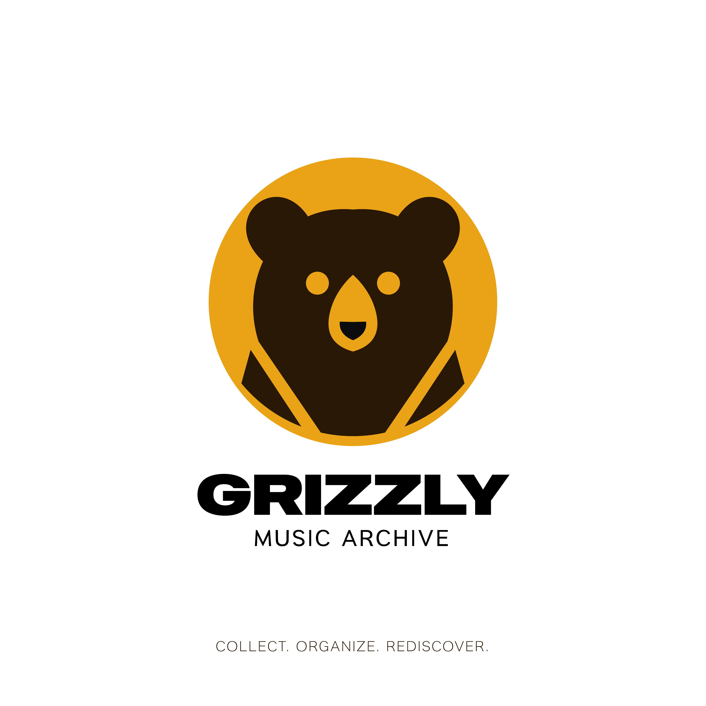
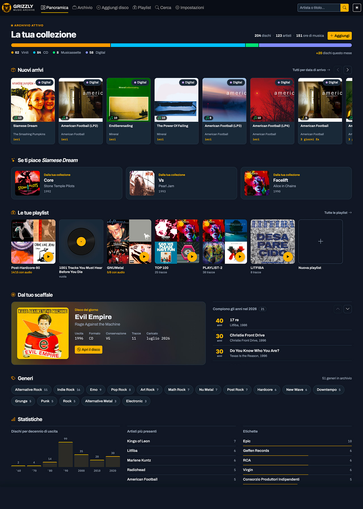
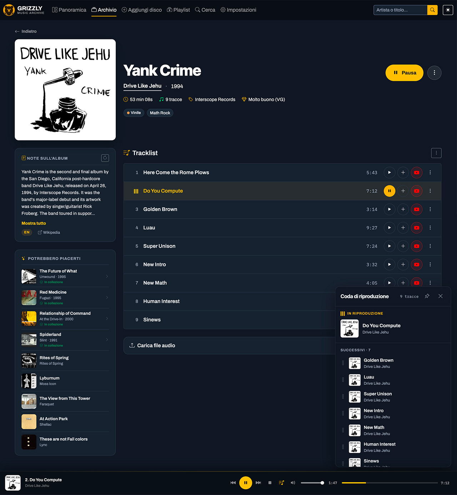
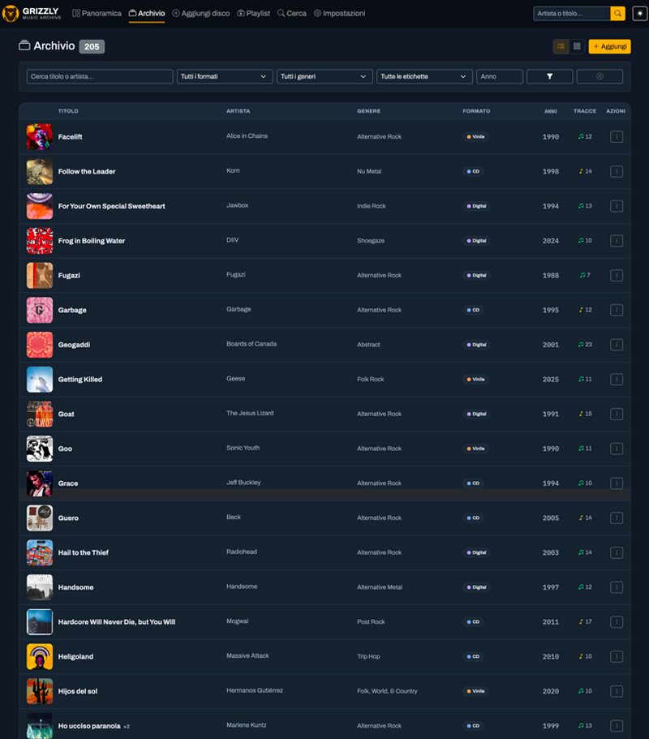
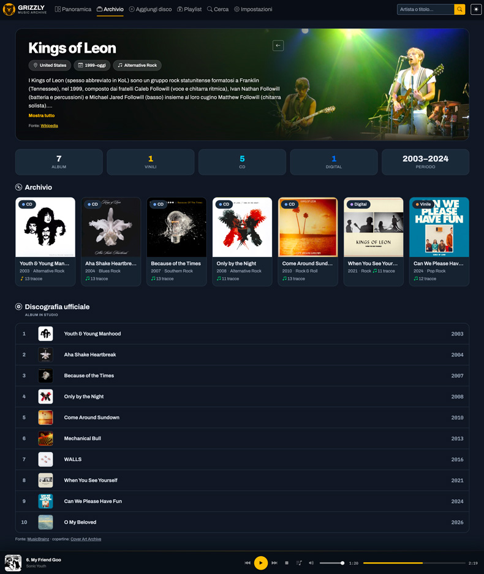
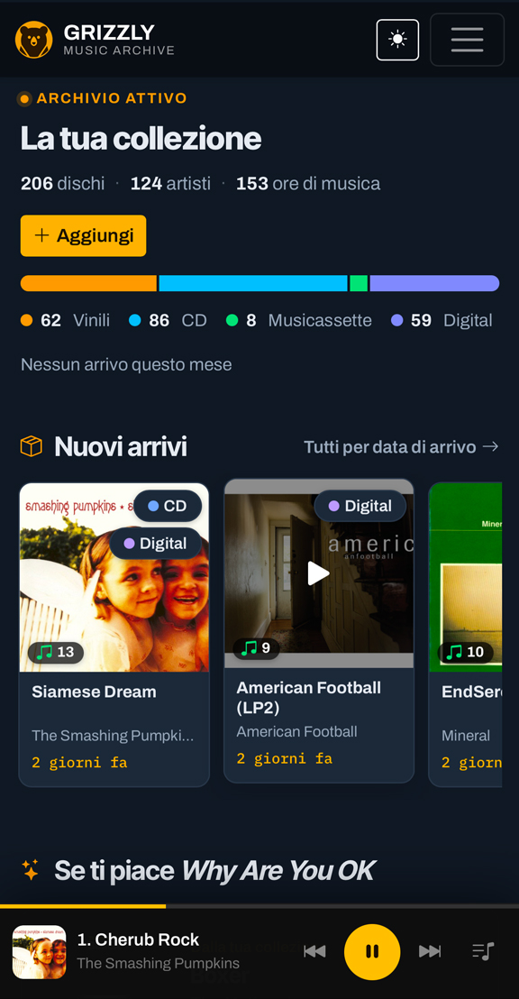
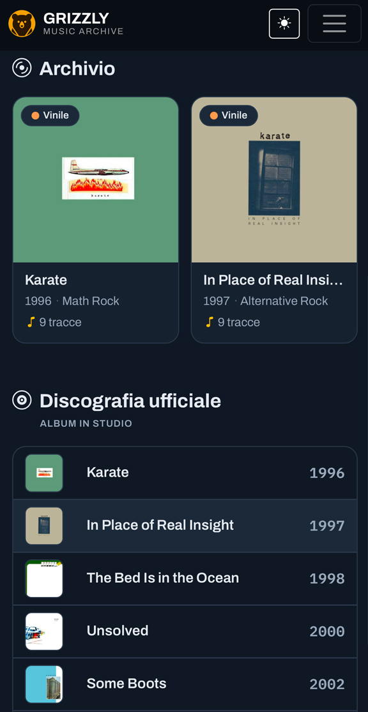

<p align="center">
  
</p>

# 🐻 Grizzly Music Archive


> A self-hosted web application for cataloguing and listening to your personal vinyl, CD, cassette and digital collection.
> **Default Docker stack:** PHP 8.3.36 + Apache and MySQL 8.0.46 (Debian variant). Bootstrap 5 · Vanilla JS. No separate frontend build step. Legacy PHP 7.4 deployments are not security-supported.

---

## ✨ Features

**Catalogue**

- Add, edit and delete albums; artists, genres and labels are created from the album form
- Cover art and tracklist from MusicBrainz and Cover Art Archive, with Last.fm and Discogs as optional fallbacks, or manual entry
- Advanced search by artist, title, format, genre, year and label
- Archive in list or grid view, with the same sorting in both
- Artist page with biography, photo, and a single list that combines the official discography with the albums in your archive
- Collection overview with recent arrivals, collection-aware suggestions, playlists, shelf picks, genres and format composition

**Listening**

- Sticky audio player for MP3 and FLAC: single-row layout, repeat (queue or track), remaining time, minute ruler and an editable play queue
- **Instant Mix**: pick genres, a period and a number of tracks, and Grizzly builds a varied mix from the files in your archive, ready to play and optionally saved as a playlist
- Playlists with drag-and-drop ordering
- YouTube lookup for tracks, with in-page preview

**Audio library**

- Upload MP3/FLAC files, one track at a time or in bulk with automatic track matching
- Automatic library scan: Grizzly watches a folder chosen in Settings and imports albums in the background
- Scanned files are indexed in place and never copied, moved or deleted
- Folders can be excluded from the scan (for example a downloads-in-progress folder)
- The watched folder can be changed later: Grizzly verifies the indexed files in the new location and updates their paths

**Other**

- Dark and light mode
- Archive export and import
- External API credentials configurable from Settings, with environment variables as fallback

---

## 🚀 Quick Start with Docker

### Prerequisites

- [Docker](https://docs.docker.com/get-docker/) and [Docker Compose](https://docs.docker.com/compose/install/)
- Port `8080` (or your chosen `APP_PORT`) available
- A compatible platform for the selected database image; the `mysql:8.0.46-debian` tag was verified on `linux/amd64`. Check image availability before deploying on ARM systems such as Raspberry Pi.

### 1. Clone the repository

```bash
git clone https://github.com/recycledesign9/grizzly-music-archive.git
cd grizzly-music-archive
```

### 2. Configure the environment

```bash
cp .env.example .env
```

Configure the address and port, and **replace the example `DB_PASS` and `DB_ROOT_PASS` credentials with unique strong passwords before the first start**:

```dotenv
BASE_URL=http://localhost:8080
APP_PORT=8080
```

If the app is reachable from more than one address (localhost, a LAN IP, a local hostname, a reverse proxy domain), list them in `ALLOWED_HOSTS`:

| Scenario                              | `BASE_URL`                     | `APP_PORT` | `ALLOWED_HOSTS`                                          |
| ------------------------------------- | ------------------------------ | ---------: | -------------------------------------------------------- |
| Local machine (Mac / Windows / Linux) | `http://localhost:8080`        |     `8080` | `localhost,localhost:8080,127.0.0.1,127.0.0.1:8080`      |
| Home or LAN server (IP address)       | `http://192.168.1.x:8080`      |     `8080` | `192.168.1.x:8080`                                       |
| Server with domain name               | `https://music.yourdomain.com` |     `8080` | `music.yourdomain.com`                                   |
| Reverse proxy + local access          | `https://music.yourdomain.com` |     `8080` | `music.yourdomain.com,192.168.1.x:8080,music.local:8080` |

- **`BASE_URL`**: canonical URL of the application, with no trailing slash. It is used when the request host is not in `ALLOWED_HOSTS`.
- **`APP_PORT`**: port exposed on the host. Change it if `8080` is already in use.
- **`ALLOWED_HOSTS`**: comma-separated hostnames or `host:port` pairs allowed to serve the app.

Keep installation-specific environment values in `.env` rather than changing `docker-compose.yml`. Behind a reverse proxy such as Nginx Proxy Manager, SSL normally terminates at the proxy and the container keeps running over HTTP.

> ⚠️ **Access control notice**
> Grizzly is designed for **personal use inside your own network**. It has **no built-in authentication**: anyone who can reach the URL can add, edit and delete albums, upload files and consume your external API quota.
> If the app is reachable from the internet, protect it at the proxy or network level, for example with **Basic Authentication / Access Lists in Nginx Proxy Manager**, an IP allow-list, or a VPN (WireGuard, Tailscale).

### 3. Start

```bash
docker compose up -d --build
```

Docker builds **PHP 8.3.36 + Apache**, starts **MySQL 8.0.46 (Debian image)** and the background scan worker, imports the schema and demo data **only when the database volume is new**, and serves the app at `BASE_URL`. Both `app` and `worker` use the same PHP image. Use `--build` the first time; afterwards `docker compose up -d` is enough. For an existing installation, read the upgrade precautions below before running Compose.

> The **first startup** can take several minutes while images are downloaded and built. Later starts are much faster.

### 4. Open the app

Open the `BASE_URL` you set in `.env`, for example `http://localhost:8080`. The archive starts with 12 demo albums (Beatles, Pink Floyd, Radiohead, Nirvana…).

To start **completely empty**, comment out the seed line in `docker-compose.yml` before the first start:

```yaml
# - ./docker/db/02_seed.sql:/docker-entrypoint-initdb.d/02_seed.sql:ro
```

**Never use `docker compose down -v` on an installation with real archive data.** It deletes all Compose named volumes, including the database and managed uploads. Existing installations must preserve their volumes and follow the upgrade procedure below.

### Stop / restart

```bash
docker compose down        # stop (data is preserved in volumes)
docker compose up -d       # start again
```

---

## 📂 Automatic scan

The folder to scan is configured **only from Grizzly**, under **Settings → Automatic scan**. No music-library path goes in `.env`.

1. Enter the **real absolute path on the host**, for example `/mnt/media/music`. Do not enter `/hostfs/...`: Grizzly maps the host path internally to `/hostfs` in Docker.
2. Turn on **Enable automatic scan**.

The worker picks up the change by itself, with no restart. Albums are imported once their folder has stopped changing, so files that are still downloading are not imported half-way.

- **Index in place**: scanned MP3/FLAC files stay in your library; Grizzly stores their path and streams them. Deleting a scanned album from Grizzly never deletes the original files.
- **Excluded folders**: subfolders listed in Settings (for example a downloader's temporary folder) are skipped together with everything inside them.
- **Changing the watched folder**: after saving a new folder, the worker checks that the albums already in the archive are in the new location and updates their paths. Settings shows the progress; until it finishes, playback keeps using the previous folder.

To follow the worker:

```bash
docker compose logs -f worker
```

---

## 🔧 Docker runtime update — PHP 8.3.36 / MySQL 8.0.46-debian

The `Dockerfile` upgrades the shared app/worker runtime from PHP 8.1 to **PHP 8.3.36**, disables `session.upload_progress.enabled` at PHP configuration level, and makes application PHP/CSS/JS/font files readable by Apache. The `docker-compose.yml` updates **only the default MySQL image** from `mysql:8.0` to `mysql:8.0.46-debian`, plus comments describing the version. **No service definitions, dependencies, mounts, environment variables or named volumes were changed.**

The Docker configuration uses a shared PHP image for the web application and scanner worker. After updating, verify dashboard, album operations, audio playback, and scanner functionality in your own environment.

### Existing installations: preserve local configuration and data

**Do not overwrite** `.env`, local Compose overrides, backups, or folders containing your music. Docker Compose merges local override files when present; confirm the **effective** database image before recreating containers. Upgrading PHP does not require a MySQL major-version change:

```bash
docker compose config -q
docker compose config | grep -E 'image: (mysql:|grizzly-music-archive:)'
docker compose exec -T db sh -c 'mysql --version'
```

If an existing installation runs an older MySQL major version, **do not point the new image at that database volume as part of a PHP update**. Keep the currently deployed database image through an installation-specific override until a database upgrade has been planned, backed up and tested independently. Major-version upgrades change the data directory and are not undone simply by restoring the old container image. See the [official MySQL upgrade documentation](https://dev.mysql.com/doc/refman/8.0/en/upgrade-binary-package.html).

### Back up before deploying

From the **existing running installation**, save copies outside the Docker build context:

```bash
umask 077
mkdir -p ../grizzly-backups
chmod 700 ../grizzly-backups

docker compose exec -T db sh -c \
  'exec mysqldump -uroot -p"$MYSQL_ROOT_PASSWORD" --single-transaction --routines --triggers "$MYSQL_DATABASE"' \
  > "../grizzly-backups/grizzly-db-$(date +%Y%m%d-%H%M%S).sql"

docker compose exec -T app tar -C /var/www/html/public -cf - uploads \
  > "../grizzly-backups/grizzly-uploads-$(date +%Y%m%d-%H%M%S).tar"
```

Verify that backups are nonempty and readable; keep an independent backup of host-stored music because external/indexed-in-place audio is not contained in `uploads_data`. Do not run `docker compose down -v`, delete Docker volumes, or alter media directories to perform this PHP update.

### Build and verify

For an existing installation, after confirming the **effective** database image is safe for the existing data directory and backing up the archive, rebuild PHP and recreate **only the web and worker containers**:

```bash
docker compose config -q
docker compose build --pull app
docker compose up -d --no-deps app worker
docker compose ps
docker compose exec -T app php -v
docker compose exec -T worker php -v
docker compose exec -T app php -i | grep session.upload_progress.enabled
```

Expected result: **PHP 8.3.36** in both `app` and `worker`, with `session.upload_progress.enabled => Off => Off`. Verify dashboard, album details, MP3/FLAC playback and scanner settings. The SQL schema upgrade to Grizzly v0.6.0 is a **separate step** described below: do not apply the upgrade migration on a newly initialized database.

A pinned image tag will not automatically receive future PHP security fixes. Follow [supported PHP versions](https://www.php.net/supported-versions.php) and validate new patched images before updating the published Dockerfile.

---

## ⬆️ Upgrading to v0.6.0

**Back up your database before upgrading.** Existing installations update to v0.6.0 with a single cumulative migration, without running earlier migration files separately. Upgrades from v0.4.0 and later are supported.

```bash
# Keep MySQL running, but stop the application and scanner during the upgrade.
docker compose stop app worker
git pull
# Confirm your effective MySQL image remains compatible with the current database volume.
docker compose config | grep -E "image: (mysql:|grizzly-music-archive:)"

docker compose exec -T db sh -c \
  'mysql -uroot -p"$MYSQL_ROOT_PASSWORD" "$MYSQL_DATABASE"' \
  < docker/db/migrations/grizzly_0.6.0_migration.sql

docker compose build --pull app
docker compose up -d --no-deps app worker
docker compose ps
```

The migration adds only what is missing and can be run again safely. Fresh installations already include the latest schema and do not require migrations. If the database image shown by `docker compose config` changed major version, preserve the previously deployed database image in a local override before proceeding. The commands above intentionally avoid recreating the database service.

---

## 🔑 API Keys (optional)

**No API key is required for the core metadata lookup.** MusicBrainz supplies album metadata and tracklists; Cover Art Archive supplies cover images. Add an album and press **Cerca nelle fonti** to look up the available details.

| Feature               | Service             | Variable          | Notes                                                                        |
| --------------------- | ------------------- | ----------------- | ---------------------------------------------------------------------------- |
| Cover art + tracklist | **MusicBrainz**     | none              | ✅ Works out of the box                                                       |
| Cover art + tracklist | Last.fm             | `LASTFM_API_KEY`  | Optional fallback, also used for similar artists. [Get a key](https://www.last.fm/api/account/create) |
| Cover art             | Discogs             | `DISCOGS_TOKEN`   | Optional fallback. [Get a token](https://www.discogs.com/settings/developers) |
| YouTube integration   | YouTube Data API v3 | `YOUTUBE_API_KEY` | Required for YouTube search and preview. [Get a key](https://console.cloud.google.com) |

Keys can be saved from **Settings → External services**, with no restart. A key saved there takes precedence over the environment variable; removing it from Settings falls back to `.env`. Saved keys are never shown back in full.

If you edit `.env` directly, recreate the application containers:

```bash
docker compose up -d --no-deps app worker
```

### YouTube embed on LAN servers

When the app is opened through a raw private IP (for example `http://192.168.1.x:8082`), YouTube may refuse some embeds with "Video unavailable". Map a local hostname to the server IP in the `hosts` file of every device that uses the app (`/etc/hosts` on macOS and Linux, `C:\Windows\System32\drivers\etc\hosts` on Windows):

```text
192.168.1.x    grizzly.local
```

Then use that hostname in `.env` and restart the containers:

```dotenv
BASE_URL=http://grizzly.local:8082
APP_PORT=8082
ALLOWED_HOSTS=grizzly.local,grizzly.local:8082,192.168.1.x:8082
```

---

## 🛠 Local Development (without Docker)

Requirements (legacy non-Docker development): PHP 7.4+ at application level, MySQL 5.7+ or MariaDB 10.6+, Apache with `mod_rewrite`. **PHP 7.4 is end-of-life and is not recommended for an exposed or production installation**; use a supported, patched PHP runtime instead. The Docker path above is verified on PHP 8.3.36.

```bash
# 1. Import the database
mysql -u root -p -e "CREATE DATABASE grizzly_db CHARACTER SET utf8mb4 COLLATE utf8mb4_unicode_ci;"
mysql -u root -p grizzly_db < docker/db/01_schema.sql
mysql -u root -p grizzly_db < docker/db/02_seed.sql

# 2. Configure the environment
cp .env.example .env
# Edit .env:
#   DB_HOST=localhost
#   DB_PORT=3306   (8889 for MAMP)
#   BASE_URL=http://localhost:8888/grizzly-music-archive   (adjust to your setup)
#   ALLOWED_HOSTS=localhost,localhost:8888

# 3. Point the Apache DocumentRoot to the project folder
# 4. Enable mod_rewrite and AllowOverride All
```

The **automatic scan** needs no extra setup without Docker. When scanning is enabled in Settings, Grizzly starts the background worker itself and shows its status in the **Worker** row. The worker keeps running when the browser is closed, stops when scanning is disabled or the database is unreachable, and is started again by the first page served after the server comes back. Nothing is registered in the operating system.

This requires macOS or Linux, a PHP 7.4+ command-line binary with `pdo_mysql` and `openssl` (MAMP and standard Linux packages include one), and a `storage/` folder writable by the web server. Logs are written to `storage/logs/media-scan-worker.log`. On Windows, Settings shows the command to start the worker manually.

To manage the worker with your own service (systemd, launchd), set `GRIZZLY_WORKER_AUTOSTART=0` in `.env` and run `php media-scan-worker.php`. Only one worker per installation runs at a time.

---

## 📁 Project Structure

```text
grizzly-music-archive/
├── docker/
│   ├── apache/vhost.conf        < Apache virtual host
│   └── db/
│       ├── 01_schema.sql        < Current database structure for fresh installs
│       ├── 02_seed.sql          < Demo data
│       └── migrations/          < grizzly_0.6.0_migration.sql (cumulative upgrade)
├── app/
│   ├── controllers/             < Album, Artist, Playlist, Mix, Settings, Media…
│   ├── models/                  < Album, Artist, Track…
│   ├── services/                < Metadata, scanner pipeline, Instant Mix, path resolution…
│   └── lib/getid3/              < Audio tag reader
├── config/                      < config.php (env-driven), database.php (PDO)
├── views/                       < PHP templates
├── public/                      < css, js, img, uploads (covers and audio, gitignored)
├── api/                         < Lightweight endpoints (YouTube)
├── docs/                        < Logo and project images
├── media-scan-worker.php        < Background scanner
├── storage/                     < Worker state and logs, created at runtime (gitignored)
├── Dockerfile
├── docker-compose.yml
└── .env.example                 < Template, copy to .env
```

---

## 🗄 Database Schema

| Table                 | Description                                                     |
| --------------------- | --------------------------------------------------------------- |
| `artists`             | Artists and bands, with MusicBrainz/Deezer identity and bio/image cache |
| `artist_discography`  | Official discography cached from MusicBrainz                    |
| `albums`              | Album metadata (title, year, condition, cover, release and release-group MBID) |
| `album_formats`       | Formats owned for each album, with manual/scanner provenance    |
| `formats`             | Vinile / CD / Musicassetta / Digital                            |
| `genres`, `labels`    | Genres and record labels                                        |
| `tracks`              | Tracklists with duration and cached YouTube ID                  |
| `audio_files`         | Uploaded audio and external audio indexed in place              |
| `playlists`, `playlist_tracks` | Playlists and their ordered tracks                     |
| `media_scan_ignored`  | Source folders of albums deleted from Grizzly, never re-imported |
| `media_scan_excluded` | Folders excluded from the automatic scan                        |
| `settings`            | Application settings, scan state and optional API credentials   |

---

## ⚙️ Configuration Reference

Infrastructure settings live in `.env` (see `.env.example`). The watched folder and the API credentials are managed from Settings.

| Variable                   | Default                                             | Description                                                    |
| -------------------------- | --------------------------------------------------- | -------------------------------------------------------------- |
| `BASE_URL`                 | `http://localhost:8080`                             | Canonical URL, with no trailing slash                          |
| `APP_PORT`                 | `8080`                                              | Host port for the web server                                   |
| `ALLOWED_HOSTS`            | `localhost,localhost:8080,127.0.0.1,127.0.0.1:8080` | Allowed hostnames or host:port pairs                           |
| `DB_HOST`, `DB_PORT`       | `localhost`, `3306`                                 | Database server (without Docker)                               |
| `DB_NAME`                  | `grizzly_db`                                        | Database name                                                  |
| `DB_USER` / `DB_PASS`      | `grizzly` / `grizzly_secret`                        | Database credentials                                           |
| `DB_ROOT_PASS`             | `root_secret_change_me`                             | MySQL root password                                            |
| `DEBUG`                    | `false`                                             | Show PHP errors (`true` only for development)                  |
| `LASTFM_API_KEY`           | *(empty)*                                           | Last.fm key, used when none is saved in Settings               |
| `DISCOGS_TOKEN`            | *(empty)*                                           | Discogs token, used when none is saved in Settings             |
| `YOUTUBE_API_KEY`          | *(empty)*                                           | YouTube key, used when none is saved in Settings               |
| `GRIZZLY_WORKER_AUTOSTART` | `1`                                                 | Without Docker: `0` stops Grizzly from starting the worker     |
| `GRIZZLY_PHP_CLI`          | *(auto)*                                            | Without Docker: path of the PHP CLI, if not found automatically |

---

## 🔒 Security Notes

- **No built-in authentication**: restrict access at the proxy or network level if the app is reachable from outside your LAN (see the access control notice above).
- **Runtime:** Docker uses PHP `8.3.36` with `session.upload_progress.enabled=0`; keep the runtime patched and rebuild both app and worker after security updates.
- **MySQL:** the default Docker image is `mysql:8.0.46-debian`. Existing installations with an older major version must keep their current database image until a separate, tested database migration is completed.
- **Host filesystem access:** the official `app` service mounts host `/` under `/hostfs` read-write, while `worker` mounts it read-only. This behavior remains unchanged for scanner/path compatibility but is broad access: run Grizzly only on trusted systems and restrict the web entry point.
- **Publishing:** do not expose an unauthenticated instance directly to the Internet. Place an authenticated reverse proxy with HTTPS or a VPN in front of it.
- Never commit `.env` to version control, and keep `DEBUG=false` outside local development.
- Credentials saved in Settings stay in the installation and are not included in archive exports.
- Audio outside the web root is streamed through PHP with strict path validation. Docker maps host paths under `/hostfs`; review per-service mount permissions in `docker-compose.yml`.
- All database queries use PDO prepared statements; uploads are validated by MIME type and extension.

---

## 🤝 Contributing

Pull requests are welcome. For major changes please open an issue first.

1. Fork the repo
2. Create your branch: `git checkout -b feature/my-feature`
3. Commit your changes: `git commit -m 'Add my feature'`
4. Push: `git push origin feature/my-feature`
5. Open a Pull Request

---

## 📸 Screenshots

### Desktop interface

<p align="center">
  
</p>

<p align="center">
  <strong>Collection overview</strong><br>
  Recent arrivals, collection-aware suggestions, playlists, shelf picks, genres and format composition.
</p>

---

<p align="center">
  
</p>

<p align="center">
  <strong>Album detail and player</strong><br>
  Album metadata, tracklist, MP3/FLAC upload, YouTube lookup and sticky audio player.
</p>

---

| Archive view                                                                                                      | Artist profile                                                                                                                                            |
| ----------------------------------------------------------------------------------------------------------------- | --------------------------------------------------------------------------------------------------------------------------------------------------------- |
|  |  |
| Searchable album table with cover, artist, format, year, genre and actions.                                       | Artist biography, discography and the albums in your archive.                                                                                             |

### Mobile interface

| Mobile dashboard                                                                                                                                   | Mobile artist page                                                                                                                         |
| -------------------------------------------------------------------------------------------------------------------------------------------------- | ------------------------------------------------------------------------------------------------------------------------------------------ |
|  |  |
| Collection overview with recent arrivals, playlists and sticky player.                                                                             | Artist page with discography and cover thumbnails.                                                                                         |

---

## 💬 Community & Support

- 🐛 [GitHub Issues](https://github.com/recycledesign9/grizzly-music-archive/issues): report bugs and request features
- ☕ [Support Grizzly on Ko-fi](https://ko-fi.com/recycledesign): help fund ongoing development

---

## 📜 License

MIT, see [LICENSE](LICENSE) for details.
